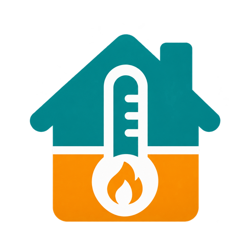

<p align="center"></p>

# Hive Virtual Thermostat for Home Assistant

Community room-temperature control with timed Hive requests, manual boost priority, sensor safeguards, a sidebar and weekly schedules. This project is not affiliated with Hive or Home Assistant.

Built by [domleblanc94](https://github.com/domleblanc94) with [OpenAI Codex](https://github.com/apps/chatgpt-codex-connector). Codex generated the implementation, tests and documentation under the owner's direction; the logo was created with OpenAI image generation. AI assistance does not imply OpenAI maintenance or endorsement.

**Experimental:** Home Assistant 2026.10.4 runtime tests use simulated Hive actions. Physical boost expiry and boiler behaviour still require the supervised tests below.

## Install and update with HACS

1. Open **HACS → menu (⋮) → Custom repositories**.
2. Add `https://github.com/domleblanc94/hive-virtual` and choose **Integration**.
3. Find **Hive Virtual Thermostat** in HACS and download it.
4. Restart Home Assistant and refresh your browser.
5. If not already configured, add **Hive Virtual Thermostat** under **Settings → Devices & services**.

For an existing manual installation, back up Home Assistant first, then let HACS manage the same hive_virtual folder. Keep the existing configured entry; do not add a second controller. HACS offers future GitHub releases as updates. After installing each update, restart Home Assistant and select Auto/Heat when ready: full restarts start the thermostat Off.

This is a HACS **custom repository**, not a claim of inclusion in the default HACS catalogue.

Already installed manually? Follow the [settings-preserving HACS migration guide](docs/hacs-migration.md).

[Releases](https://github.com/domleblanc94/hive-virtual/releases) · [Issues](https://github.com/domleblanc94/hive-virtual/issues) · [Validation](docs/validation.md)

## Operation and manual installation

## Choose how Hive takes over

Open **Settings → Devices & services → Hive Virtual Thermostat → Configure → Safety limits and heating requests** and enable **Keep Hive’s own mode and target**. Once any active boost ends, set Hive to Manual and choose the temperature on the Hive app or physical thermostat. You can also select Hive’s own schedule. Hive can heat independently between boosts, during a Home Assistant outage or sensor fault, and while the virtual thermostat is Off.

With that option disabled, Home Assistant sets a **Fixed fallback target** of 7–30°C, within the device’s limits and below the boost target. Existing installations retain their current fallback until changed.

## Edit and monitor from Hive Heating

Thermostat controls stay above the **Schedule**, **History**, and **Gas & costs** tabs. In **Schedule → Edit schedule**, set **Start** and **Area** for each period to choose when control switches floors. Select **Follow schedule** on the thermostat. Each gas sensor field supports search by name or entity ID.

After updating through HACS, restart Home Assistant and refresh the browser. Select **Auto** again when ready (a full restart still starts Off). Existing settings, schedules, faults and pending request deadlines are retained.

- **Edit schedule:** change built-in weekly periods directly on the heating page. If you use a native Schedule helper, the same button edits that helper's blocks, including start/end, target, area and days. Native YAML-defined helpers remain read-only here. Other custom block data is preserved. Invalid periods/overlaps are rejected; stale editor revisions are rejected for integration settings, with a best-effort change check for native helpers.
- **Heating history:** an on/off/unavailable timeline based on Hive's reported heating action, including manual boosts. It is not inferred from the virtual thermostat's requested demand. Missing or stale Hive reports remain unavailable.
- **Temperature history:** upstairs/downstairs averages and the virtual target, with 24-hour, 48-hour and 7-day ranges. Recorder/History must be enabled and retain the relevant entities. New sensors begin collecting after this upgrade; the page does not invent earlier data or fill unavailable gaps. The graph uses browser-local time labels; schedule evaluation uses Home Assistant's timezone.
- **Configure costs:** select daily gas usage, an optional existing daily cost sensor, unit-rate and standing-charge sensors from the page. These settings require an administrator, as does schedule editing. Ordinary thermostat controls retain Home Assistant's normal service permissions.

### Cost inputs and their limits

Use a **daily** usage sensor, such as your gas provider's gas consumption today, rather than a lifetime total. Supported energy units are kWh, Wh and MWh. For m³, explicitly supply your supplier/meter's kWh-per-m³ conversion factor; the integration does not assume one. Other units are unsupported. A sensor marked unavailable or a nonnumeric value produces an unknown estimate, not zero.

Select whether the tariff is in major currency per kWh (for example GBP/kWh) or pence/cents per kWh (divide by 100). A second checkbox applies independently to the daily-cost and standing-charge sensors. These are explicit input settings, not automatic currency conversion. Configure the matching three-letter currency code.

**Heating-only estimate = recorded reported heating hours × configured average gas INPUT power in kW × current unit rate.** Use an appropriate average input power for your boiler while heating; nameplate maximum output is not the same thing. Modulation, sensor latency and unobserved intervals make this an estimate, not a meter reading. It is disabled until a positive input-power value and valid tariff are configured. The current rate reprices the day's estimate; historical tariff changes are not integrated.

Whole-house gas cost is either the selected daily cost sensor, exactly as reported, or daily energy × current rate. It can include hot water/cooking. A daily cost sensor may already include standing charges, so the standing charge is always shown separately and is never automatically added. The heating-only estimate and household spend must not be added together.

Heating hours use only observed, fresh Hive heating reports. Unknown gaps and intervals longer than two minutes are omitted. Daily counters reset at Home Assistant's local midnight, persist across restarts, and can lose up to five minutes on an abrupt host failure. They are approximate monitoring data, not billing or certified metering. Money/daily-estimate sensors are recorded for history but are not advertised as Energy Dashboard cumulative meters.

The previous failed validation email concerned the initial missing HTTP dependency declaration; it was corrected before the first release. HACS, unit tests and Home Assistant packaging validation run on every push and release.

A community Home Assistant integration that controls one Hive heating zone from upstairs/downstairs room temperatures. It uses your existing official Hive integration and does not require another Hive login. It is independent of the Hive EV project.

## What changed

- Hive Heating is registered automatically in the sidebar for UI-configured controllers. No dashboard YAML is needed; older manually created dashboards can be removed separately to avoid duplicate titles.
- Native Schedule helpers are supported for graphical weekly editing. The existing built-in weekly schedule remains available for backwards compatibility.
- Saving settings updates the running controller in place and retains Auto/Heat/Off, pending request deadlines, sensor references and serious fault latches. A full Home Assistant restart still starts Off.
- Pending boosts are saved BEFORE the cloud request. Fault latches and sensor references are retained in Home Assistant storage. Storage failures block new requests.
- A problem binary sensor, Reset heating fault button and optional persistent fault notifications are added. Notifications change only when the fault changes; they are not repeated on each poll. The problem sensor can drive your own phone-notification automation.
- Configurable pause between requests (default 2 minutes), including a pause after an observed Hive boost ends. Active boosts are never renewed or cancelled.
- Optional actual-device-report timestamp sensors can detect stale data even when an upstream integration republishes cached temperatures.
- An original house/thermometer logo is included in `custom_components/hive_virtual/brand`, with 256px and 512px icon/logo variants. Home Assistant 2026.3+ supports these local brand assets. This is not an official Hive or Home Assistant logo.

## Install or upgrade

1. Disable competing old thermostat/boost automations. Use only one controller per physical Hive zone.
2. Replace `/config/custom_components/hive_virtual` with the complete `custom_components/hive_virtual` folder from this ZIP. Include the new frontend, brand, binary_sensor, button, panel and translation files.
3. Restart Home Assistant fully and refresh the browser. Existing UI entries/options remain usable. If setting up for the first time, go to Settings → Devices & services → Add integration → Hive Virtual Thermostat, then select Hive and your room sensors. Do not also add a YAML controller for the same zone.
4. Before first use, end any old boost and check the underlying mode and target in Hive. For the default fixed fallback, set Hive to manual 7°C. For Hive-managed fallback, select your preferred mode and target on Hive.
5. Open Hive Heating in the sidebar. If hidden by personal sidebar preferences, enable it there. The automatic page has URL `/hive-virtual-heating`; an older manual dashboard may have `/hive-heating`.
6. Choose Auto to follow the selected schedule, or Heat for a manual hold. Complete the supervised hardware tests below before relying on the offline protection.

Home Assistant's temperature display unit must be Celsius in this trial. Individual room sensors may report °C or °F. The sidebar page is local and provides temperature, mode, faults, target adjustment, reset and links to the native settings screens. Admin privileges are needed to edit integration settings/helpers; ordinary users with control access can operate the thermostat.

## Recommended schedule: native Home Assistant helper

1. Settings → Devices & services → Helpers → Create helper → Schedule.
2. Name it House Heating and draw your weekly time blocks. Split overnight blocks at midnight.
3. Edit each block's Additional data. For example:

```yaml
temperature: 20.5
area: Downstairs
```

Use `Upstairs` for overnight blocks, or exactly match your configured YAML area name. Temperatures must be numeric and from 7 to 30°C.

4. Open Hive Virtual Thermostat → Configure → Schedule source. Enable Use a native Schedule helper and select it.
5. Select Auto. Future schedule edits apply through helper state/attribute updates without restarting the controller.

The helper's block controls both area and target. An uncovered time block means no NEW heating request; an active Hive boost continues. Missing or invalid schedule data blocks new heating and raises a fault. Disabling the helper option restores the built-in weekly schedule. The sidebar contains links to helper settings and integration options; the graphical calendar editor is Home Assistant's existing helper editor.

## Existing built-in schedule and manual control

Configure → Weekly temperature schedule still supports adding, editing and deleting periods with start time, target, area and weekdays. Each period applies until the next matching period, including overnight/week wrap. Default setup creates daily examples: 06:30 downstairs 20°C; 08:30 downstairs 17°C; 17:00 downstairs 20.5°C; 22:00 upstairs 18°C. These are examples, not an import of your old schedule.

Auto follows the selected schedule. Adjusting a target while in Auto selects manual Heat until you choose Auto again. Heat uses the default feedback area (or `active_area_entity` for advanced YAML setups). Off prevents new heating requests. A complete HA restart starts Off; choose Auto/Heat again when appropriate. Settings edits no longer force Off. Deleting every built-in period without selecting a helper leaves no usable Auto schedule.

## Heating requests and offline behaviour

In fixed-fallback mode, the controller confirms the configured Hive target and manual mode. With Hive-managed fallback, it leaves both settings to Hive. It then requests heat ONLY with timed Hive boosts: 5 minutes by default, adjustable 1–15 minutes. The request deadline plus cooldown is durably saved before contacting Hive. A lost/failed response cannot trigger an immediate repeat. Matching fallback targets are not written repeatedly. Fresh Hive state after startup is required before new requests.

If Home Assistant stops, it cannot request another boost. The last controller boost should expire through Hive and return to the underlying Hive settings. Verify expiry and return temperature on your model with Home Assistant powered off. Hive can still call for heat at the underlying target.

There is ONE Hive boost channel. The controller never cancels or extends an active boost, whether started by HA or a person. You can start/extend/cancel boosts in Hive. A manually extended boost follows YOUR duration and temperature, not the controller limit. Meeting the room target, selecting Off, or detecting a bad sensor prevents new requests but does not interrupt a running boost. Controller heat may therefore continue for its remaining duration after a fault. This is the tradeoff for preserving manual boosts without guessing who owns them.

Cloud polling creates a remaining race: an app boost started just before an HA command may not yet be visible. The supported climate entity provides no atomic ownership check. This release rechecks known boost state before issuing a request, but cannot guarantee independent simultaneous control. Replacing the custom integration with automations would not remove that cloud limitation.

Timed pulses can produce overshoot/cycling. Choose a sensible `call_temperature` ceiling (UI default 25°C), boost duration, deadband and cooldown while observing your heating system. The real Hive sensor can stop demand at the ceiling even if the remote rooms are cold. Area selection changes which sensors the virtual thermostat uses. Hive still measures its own temperature, and radiators remain in the same physical heating zone. With Hive-managed fallback, Hive’s native schedule can continue outside boosts.

## Sensor checks and fault reset

All sensors in the selected area must be available, numeric, finite, have a supported temperature unit and have reported within the timeout (UI default 30 minutes). Each reading is checked BEFORE averaging:

- Plausible range: default 5–35°C.
- Sudden change: default more than 3°C within 10 minutes of the last accepted observation.
- Area disagreement: default spread greater than 6°C.
- High-temperature cutoff: any selected sensor at or above 28°C.

Range/jump/disagreement/high-temperature faults latch and survive restarts. Check the sensors, select Off, press Reset heating fault, then select Auto/Heat. Off→Heat alone no longer clears a serious fault. Reset fails while heating is enabled or readings remain invalid. A reset clears jump history, so the first plausible reading after reset cannot be independently verified. Missing/stale/nonnumeric readings block demand and recover automatically once valid.

The Heating fault binary sensor is on for current problems. Optional persistent notifications are enabled by default under Configure → Safety limits. Storage errors require correcting the underlying disk/storage problem and restarting; the ordinary sensor reset does not bypass failed safety storage. A pending request/cooldown is never cleared by resetting a sensor fault.

### Actual-device freshness (optional advanced setting)

HA's report timestamp can be refreshed by an upstream integration publishing cached data. If your sensor integration exposes an ISO timestamp for the ACTUAL measurement/radio report, map the temperature entity to that timestamp entity in the optional sensor-report mapping, for example:

```yaml
sensor.bedroom_temperature: sensor.bedroom_last_measurement
sensor.living_room_temperature: sensor.living_room_last_measurement
```

Leave this empty unless genuine timestamp entities exist. The mapping is available in setup/sensor options and YAML as `sensor_report_entities`. Future/invalid/old source timestamps block heat. This does not manufacture missing telemetry: constant plausible false readings, slow drift and fake freshness remain undetectable without independent sensor evidence. Only selected-area sensors are checked. Using individual sensors provides more information than a precomputed average.

## YAML compatibility

Existing `climate: - platform: hive_virtual` setups still work. The examples show the original engine settings. New YAML settings are `schedule_entity`, `cooldown_minutes` (1–60, default 2), `notifications` (default true), and `sensor_report_entities` (mapping, default empty).

Automatic sidebar/problem/button entities are provided for UI-created config entries. YAML controllers have persistent state and notifications; use the supplied dashboard example and the `hive_virtual.reset_fault` action with the virtual `entity_id` for explicit fault reset, or migrate to UI setup. Do not run both paths for one zone. Old dashboard reset instructions should be updated to use the new reset button/action.

## Verification before unattended use

The release includes offline control/config-flow/storage/notification tests and a real-Home-Assistant runtime smoke-test script (`tools/check_virtual_runtime.py`) using simulated sensors/Hive actions in an isolated container. That test never logs into Hive or controls actual heating. Browser rendering of the sidebar is checked separately. See the workspace validation report for the exact runtime outcome/version.

On your system:

1. Set up the desired fallback. Enable Heat above the room average and confirm the requested duration/target in the Hive app.
2. Power off Home Assistant mid-boost. Confirm Hive ends that timed boost and returns to the selected fallback mode and target. Observe actual boiler demand. Do not rely on the failsafe until this passes.
3. With HA running, extend/start a manual Hive boost, change virtual targets and select Off. Confirm no early cancellation. Cancel in Hive when desired.
4. In a test setup, inject an out-of-range/suddenly low reading. Confirm the problem sensor/notification and that no further boosts start. Restart HA and verify the fault remains. Correct the sensor, use Off → Reset fault → Auto/Heat.
5. Edit a native schedule block and an integration setting. Confirm the running mode and pending cooldown are retained. Check a midnight area change, helper gaps and Off after a full restart.

Do not remove/edit Home Assistant's private safety-storage files to bypass a fault or cooldown. External automations, Hive radiator Heat On Demand, other users or app commands can change the baseline and undermine the controller's fallback. Restore your desired Hive native mode/schedule yourself after disabling/removing this integration.

Official references: [Hive controls](https://www.home-assistant.io/integrations/hive/), [Schedule helper](https://www.home-assistant.io/integrations/schedule/), [custom panels](https://contributors.home-assistant.io/frontend/custom-ui/panel/), [local brand images](https://contributors.home-assistant.io/core/integrations/brands/).
